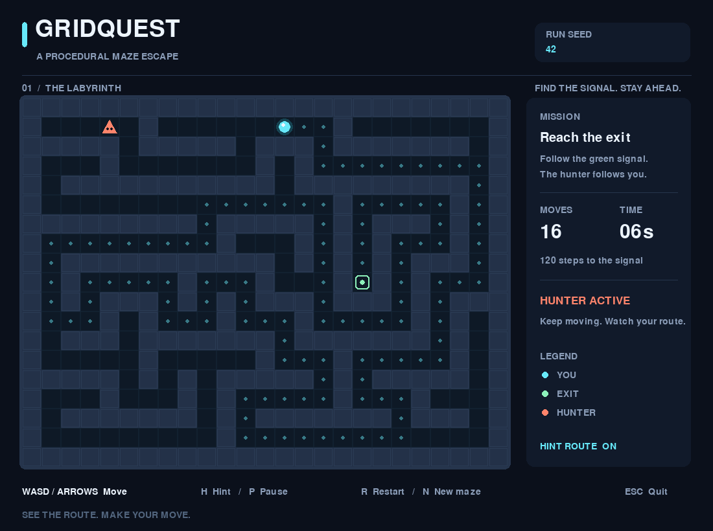

# GridQuest

**Find the signal. Stay ahead of the hunter.**

A compact Python game built with Pygame: escape a seeded procedural maze while a hunter follows your shortest trail. The whole maze is visible, so the challenge is reading the route quickly and keeping your head start.



## Play

Requires **Python 3.12 or later**, pip, and a graphical desktop. Tested locally with Python 3.12.14 and Pygame 2.6.1 on Linux; Windows instructions use the same Python package, but have not been manually tested on Windows.

### Windows (PowerShell)

```powershell
git clone https://github.com/BhuvanM17/gridquest-python.git
cd gridquest-python
py -3.12 -m venv .venv
.\.venv\Scripts\python.exe -m pip install -e .
.\.venv\Scripts\python.exe -m gridquest
```

### Linux / macOS

```bash
git clone https://github.com/BhuvanM17/gridquest-python.git
cd gridquest-python
python3.12 -m venv .venv
.venv/bin/python -m pip install -e .
.venv/bin/python -m gridquest
```

On some Linux distributions, install the system's `python3.12-venv` package first. No art downloads, API keys, network connection, or audio device are needed to play.

To replay the screenshot's maze:

```bash
python -m gridquest --seed 42
```

Run this command with your virtual environment's Python, or activate that environment first. Installation also adds a `gridquest` command.

## Controls and rules

| Key | Action |
| --- | --- |
| Arrow keys / WASD | Move one tile; hold to repeat |
| H | Toggle the computed shortest route to the exit |
| P | Pause / resume, including the hunter and clock |
| R | Restart the current seed |
| N | Start the next seed |
| Esc / window close | Quit |

You are the cyan circle. Reach the green portal to win. The orange triangle is the hunter: touching it ends the run, including on the exit tile. Walls block movement; diagonals are not allowed.

You get **five seconds** to leave the entrance before the hunter starts there. After that, it recomputes the shortest path to your current position and advances one tile every **0.42 seconds**. Move decisively, avoid dead ends, and use the optional hint if you need help. The hunter initially sits beneath you at the entrance; it becomes visible as soon as you move away. Returning to its tile is dangerous even during the head start. A win or loss freezes the run until you restart or choose another seed. Restart and next-maze preserve your hint preference.

Every maze has a connected escape route. A perfect maze has a unique route between any two floor cells; placing the hunter at the entrance with a head start avoids blocking the only exit route at the start of the run. No seed guarantees a win if you hesitate or turn back.

## How it works

- **Generation:** iterative randomized depth-first search carves a 25 × 19 grid. A local seeded RNG makes layouts reproducible. Breadth-first search picks the furthest reachable cell as the exit.
- **Pathfinding:** BFS returns an inclusive shortest path, used independently by the hunter and hint display. With equal-cost orthogonal moves, BFS gives an exact shortest route.
- **Rules:** the pure Python `core.py` module handles legal moves, collision precedence, maze generation, and terminal states. It imports no Pygame code.
- **Presentation:** `app.py` owns input, a 60 FPS frame limit, hunter timing, pause/restart, and rendering. Shapes and Pygame's built-in font provide the entire visual design.

```text
src/gridquest/core.py   Maze data, generation, BFS, game rules
src/gridquest/app.py    Pygame view, input, timers, command line
src/gridquest/__main__.py
tests/                 Rule and SDL-dummy integration tests
```

The grid is deliberately small; BFS takes O(V + E) time and memory, while generation takes O(width × height). There is no recursion-depth limit in generation.

## Development and verification

```bash
python -m pip install -r requirements-dev.txt
python -m pip install --no-deps -e .
python -m pytest -q
ruff check .
ruff format --check .
```

The tests cover connectivity across seeds, deterministic generation, invalid sizes, shortest and unreachable routes, legal movement, enemy pursuit, collision and exit precedence, pause/restart, keyboard controls, and real command-line PNG rendering. Display integration uses SDL's dummy video driver, so CI needs no desktop. GitHub Actions runs these checks on Python 3.12 / Ubuntu.

Create a reproducible headless preview:

```bash
python -m gridquest --seed 42 --screenshot docs/screenshot.png
```

The screenshot command renders one frame with hints enabled and exits. It selects SDL's dummy display driver when `SDL_VIDEODRIVER` is unset. For headless execution, leave that variable unset or set it to `dummy`.

## Scope and authorship

A focused portfolio project by **Bhuvan M**, created with AI assistance for implementation, tests, and documentation. It demonstrates procedural generation, graph search, separation of rules and presentation, reproducible debugging, and automated checks. This is an initial playable release: one maze size and speed, keyboard controls, no audio, no save system, no online features, and no packaged executable. Desktop play feel has not yet been verified by a human; automated tests exercise real Pygame with a headless display.

License: [MIT](LICENSE). All visual assets are drawn by the game; there are no third-party art assets.
